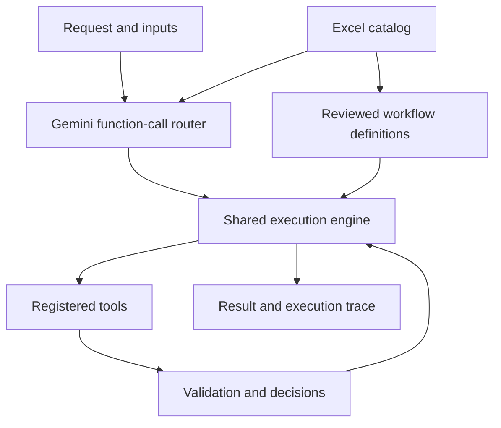

# Excel Workflow Agent

A Python application that selects and executes business workflows from an Excel catalog. Gemini identifies the workflow and extracts inputs; a shared engine runs registered tools, validates business conditions, and returns a step-by-step execution trace.

## Setup

Requires Python 3.11 or later.

```bash
python3 -m venv .venv
source .venv/bin/activate
pip install -r requirements.txt
cp .env.example .env
```

Set `GEMINI_API_KEY` in `.env`, then start the application:

```bash
python -m agent --mode live serve
```

Open **http://127.0.0.1:8000**. Select a workflow to display its input form, or use **Find input fields** for a custom request. Required fields appear first, optional details are collapsed, and JSON is available under **Advanced**. **Fill with sample data** loads an example.

For Windows, activate the environment with `.venv\Scripts\activate`.

## Configuration

| Variable | Default | Purpose |
|---|---|---|
| `GEMINI_API_KEY` | Required in live mode | Gemini API credential |
| `GEMINI_MODEL` | `gemini-3.5-flash-lite` | Model for routing and generation |
| `GEMINI_TIMEOUT_SECONDS` | `90` | Network timeout, configurable from 5–180 seconds |
| `GEMINI_REASONING_EFFORT` | `low` | Model reasoning effort |
| `GEMINI_MIN_INTERVAL_SECONDS` | `15` | Minimum interval between API requests in this process |

The adapter uses Google's OpenAI-compatible REST endpoint. Credentials stay on the server and `.env` is excluded from Git.

## Architecture



`data/workflows.xlsx` is loaded at startup. `data/definitions.json` binds its written steps to executable tools and supplies input-form metadata. A source comparison rejects stale definitions when the Excel workflow changes. Gemini selects from the loaded catalog through `execute_workflow` function calling. The engine validates the selection and inputs before dispatching registered tools. Calculations and business rules execute in Python.

## Implemented workflows

| ID | Workflow | Main rule |
|---|---|---|
| WF001 | Inventory Restock Check | Stock below minimum; reorder the difference |
| WF002 | Product Price Validation | Match SKU; flag absolute variance above 10% of vendor price |
| WF003 | Vendor File Processing | Normalize columns; reject rows missing SKU or product name |
| WF004 | Product Description Generator | Generate content from supplied facts and list missing details |
| WF005 | Customer Order Status | Look up order ID/email; request another identifier if absent |
| WF006 | Duplicate Product Detection | Exact normalized SKU or similar name with matching attributes |
| WF007 | Marketing Campaign Brief | Require goal and dates before generating |
| WF008 | SEO Keyword Classification | Deduplicate; classify intent, category, priority and target page |
| WF009 | Employee Task Assignment | Require matching skills and available capacity; otherwise escalate |
| WF010 | Workflow Performance Report | Flag failure rate above 10% or average duration above threshold |

Inventory replenishes to the minimum stock level. Price comparison reports unmatched SKUs and zero vendor prices separately. Duplicate similarity uses a 0.85 name threshold and at least two matching attributes. Employee capacity uses task-count units. Performance reporting defaults to 1000 ms and excludes clarification outcomes from completed execution rates.

## Running and testing

```bash
# Offline fixtures; no LLM requests
python -m agent --mode demo serve

# Individual live request
python -m agent --mode live run "Where is order ORD-1001?"

# Gemini connectivity check
python -m agent --mode live check

# All ten examples
python -m agent --mode live examples

# Automated tests
python -m unittest discover -s tests -v
```

All ten example requests and their inputs are in `examples/requests.json`. Recorded successful live runs are in `examples/live_results.json`. Export paths in captured results are relative; CSV/JSON export files are regenerated when workflows run. Automated validation includes **75 tests** covering workflow execution, strict thresholds, malformed inputs, clarification, quota handling, bounded retries, output correction and an eleventh-workflow extension. GitHub Actions runs the tests and offline examples.

Custom input files must be placed in `data/`; pass their relative filenames through the form or `--inputs`. For example:

```bash
python -m agent --mode live run "Process this vendor file" --inputs '{"file":"vendor.csv"}'
```

## Conditions and errors

Results distinguish `success`, `needs_input` and `error`. Traces record tool names, statuses, durations, attempts and outputs. Clarification steps use `needs_input`; quota failures use `rate_limited`. Routing retries transient failures once; tools allow up to three attempts. HTTP 429 pauses example execution and marks remaining requests `not_run`. Invalid keyword reports receive one correction attempt and are rejected if still invalid.

Blank form placeholders are ignored, while numeric zero is preserved. Required fields, field types, file paths and numeric values are validated. Generated CSV formula prefixes are escaped. Runs are saved under `runs/<run_id>/result.json`.

## Extending the catalog

Add an Excel row and its reviewed definition, including tool steps, required inputs and form metadata. Reuse existing tools where possible; register a new tool for a new capability. Add an example and tests. The engine, live router and shared form renderer do not require workflow-specific changes.

## Current scope

Order/shipment APIs and business datasets are simulated. Demo mode is deterministic; live mode uses Gemini. Generated content and inferred keyword classifications require review. This is a local, single-process application with no browser file upload. Duplicate comparison is limited to 2000 products. Multi-user deployments would require concurrent workers, shared rate limiting and persistent storage.
