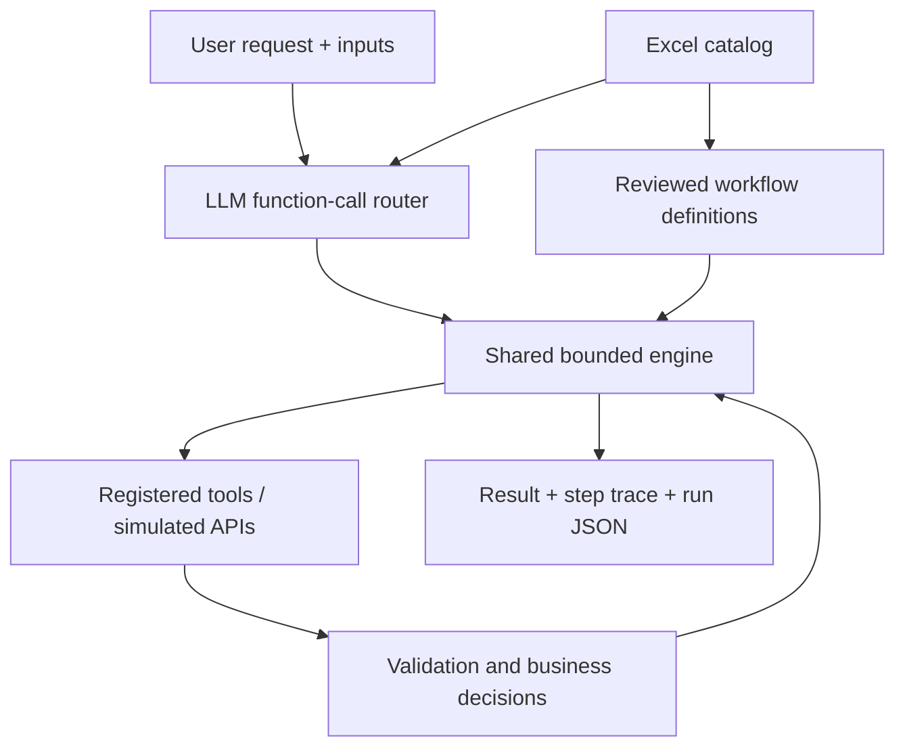

# Excel Workflow Agent

A reusable Python agent for the **Webvory AI Agent Workflow Automation** assessment. One LLM router chooses a reviewed Excel workflow; one shared runtime invokes reusable registered tools, evaluates business rules and produces an execution trace. All ten supplied workflows are implemented.

## Quick start (Python 3.11+)

```bash
python3 -m venv .venv
source .venv/bin/activate
pip install -r requirements.txt
python -m agent --mode demo serve
```

Open **http://127.0.0.1:8000**. Choose a **Workflow input template** to see blank fields and required-field help. Use **Fill with sample data** to load a runnable example, or enter your own values and click **Run workflow**. For a custom request, **Find input fields** asks the agent to identify the workflow and show its template without running business tools. The page displays the selected workflow, short selection explanation, tool calls, durations, final result and a downloadable execution JSON.

Windows activation: `.venv\Scripts\activate`.

### Live LLM mode — required for the AI demonstration

```bash
cp .env.example .env
# Edit .env locally and set GEMINI_API_KEY to your own key.
python -m agent --mode live serve
```

Create a Gemini API key at https://aistudio.google.com/apikey. The sample configuration uses `GEMINI_MODEL=gemini-3.8-flash`; set it to a text/function-calling model available to your account if needed.

The key remains on the Python server; it is never sent to the browser or included in the repository. The model is configurable using `GEMINI_MODEL`. Live mode calls Google Gemini through its documented OpenAI-compatible REST endpoint, with required `execute_workflow` function calling for routing and argument extraction, then dispatches that call into the reviewed shared runtime. Requests go to `generativelanguage.googleapis.com`, not OpenAI. No OpenAI key or OpenAI Python package is needed. Extracted business inputs are encoded in a typed `inputs_json` string and parsed/validated before execution, avoiding untyped dynamic function parameters. Product content, campaign messaging and keyword classification use the LLM. Calculations, matching, validation and execution order are deterministic Python tools.

**Offline demo is a test backend, not an LLM.** It uses catalog keywords and deterministic text fixtures. It works without credentials and is visibly labelled. It must not be presented as proof that live LLM integration was tested. There is no silent fallback from live to demo.

### Diagnosing Gemini connection problems

After changing `.env` or pulling an update, stop the old server with Control+C and restart it. A running Python process does not reload edited files.

```bash
python -m agent --mode live check
```

This sends a minimal request directly to Gemini without the Excel catalog or tools. If it times out, the issue is on the API/network path rather than business inputs. Check internet access, proxy/VPN settings and the model available in your Google AI Studio account. HTTP 401/403 indicates authentication/access; 404 usually indicates an unavailable model; 429 indicates quota/rate limits; 503 indicates a temporary service failure. A 429 pauses the batch rather than repeatedly sending more requests. Waiting may help a per-minute limit, but does not resolve an exhausted daily quota. View the model-specific limits for your project in Google AI Studio. The error does not expose your key.

Optional `.env` settings:

```env
GEMINI_TIMEOUT_SECONDS=90
GEMINI_REASONING_EFFORT=low
GEMINI_MIN_INTERVAL_SECONDS=15
```

SSL read timeouts are converted into an actionable Gemini error, rather than the raw “read operation timed out” message. Increasing a timeout only allows more waiting; it cannot repair a network or service outage.

### Guided business inputs

Each reviewed workflow definition includes `input_template`, `input_help` and `input_note`. The catalog endpoint supplies these to the UI. Empty strings, nulls, empty arrays and empty objects are placeholders and are removed before routing and execution; numeric zero is preserved. Blank optional file fields use the documented sample files. A missing-input response contains the same template so users can complete it without opening the source code.

`POST /api/prepare` accepts the same request/inputs as `/api/run`, but only identifies the workflow and returns its fields. It does not execute business tools or create a workflow run. In live mode it consumes a Gemini routing request; choosing a known template in the dropdown makes no LLM request. Run still selects the workflow from the user's request independently of the template choice.

### CLI and tests

```bash
python -m agent --mode demo run "Which products need restocking?"
python -m agent --mode demo run "Where is order ORD-1001?"
python -m agent --mode demo run "Process this vendor spreadsheet and show invalid rows." --inputs '{"file":"vendor.csv"}'
python -m agent --mode demo examples
python -m unittest discover -s tests -v
# Requires a configured key; checks actual LLM routing/content on all ten examples:
python -m agent --mode live examples
```

`--inputs @inputs.json` reads an input JSON file. The router receives both the natural-language request and explicit business inputs. Missing fields do not make an otherwise recognizable workflow unsupported: the shared engine performs required-field validation after selection. JSON inputs supplied explicitly override values inferred from the user request. Never commit your credentials or personal customer data. To use your own input CSV/XLSX, place it in `data/` and pass its relative filename. The browser does not implement upload; this is deliberately a local application.

## Architecture



The Excel file is loaded at startup. Every original field (ID, name, trigger, inputs, steps, decision logic, tools, expected output) is preserved in the catalog and supplied to the live router. `data/definitions.json` contains manually reviewed bindings from that prose into named tool steps. Exact source equality is checked: modifying a workflow's Excel prose without updating its reviewed binding causes startup to fail rather than silently executing stale logic.

This is a small custom agent/workflow framework rather than ten chatbots. `Engine` is workflow-agnostic; domain tools never route requests or depend on workflow IDs. The LLM chooses a workflow and extracts inputs; it cannot execute arbitrary Python, SQL, paths outside `data/`, or tools outside the registry. Business tools can be replaced with real API adapters without changing the router or engine.

## All ten workflows

| ID | Workflow | Main result and decision |
|---|---|---|
| WF001 | Inventory Restock Check | Stock below minimum; reorder quantity = minimum − current |
| WF002 | Product Price Validation | Match normalized SKU; absolute variance relative to vendor price; flag >10% |
| WF003 | Vendor File Processing | Normalize columns; split missing SKU/name rows; cleaned CSV and invalid JSON |
| WF004 | Product Description Generator | Description, short description, SEO title, meta; explicit missing-information list |
| WF005 | Customer Order Status | Validate ID/email; simulated order and shipment API; ask for another ID if absent |
| WF006 | Duplicate Product Detection | Exact normalized SKU = definite; similar name plus matching attributes = possible |
| WF007 | Marketing Campaign Brief | Require goal and dates; objective, audience, messaging, channels, timeline, checklist |
| WF008 | SEO Keyword Classification | Deduplicate; four intents; category, priority and suggested page; CSV export |
| WF009 | Employee Task Assignment | All required skills and free capacity; rank; recommendation or escalation |
| WF010 | Workflow Performance Report | Failure/success rates, durations, frequent errors, slow steps and recommendations |

Detailed source interpretation: [docs/workflow_matrix.md](docs/workflow_matrix.md).

## Decisions and assumptions

- Inventory uses top-up-to-minimum quantities because the source gives no supplier pack size or target stock.
- Price variance is `abs(internal − vendor) / vendor × 100`. Exactly 10% is allowed. Zero vendor prices and unmatched products are explicit exceptions, not division errors. Money comparisons use `Decimal` to preserve the threshold boundary.
- Product name is required to generate content. Other missing product facts are listed, and the prompt forbids invented features. Field/type and SEO length validation are deterministic; factual accuracy of prose still requires human review.
- Order email can match multiple orders; all matches are returned. If both ID and email are supplied, both must match. Unshipped orders do not acquire invented tracking numbers. API fixtures are clearly simulated.
- Duplicate names are compared using `SequenceMatcher`, threshold 0.85, plus at least two matching nonempty category/material/color fields. Pair evidence and confidence are exposed. Connected candidate groups require review before merging. This demo's O(n²) matcher caps input at 2000 products; production should use blocking/indexed search.
- Campaign goal and dates are mandatory. Optional products, audience and promotion are marked missing when absent. Dates are supplied strings; production should add locale/date range validation.
- Keywords require explicit category information. The model must return each deduplicated keyword exactly once with a valid intent, priority, category and suggested relative page beginning with a single `/`. Harmless enum casing/whitespace is canonicalized; unknown labels and invalid paths are rejected. A malformed keyword report gets one bounded correction call containing field-specific validation errors. Reports still invalid after correction are not exported. The final report records `generation_attempts`. Priority is qualitative: no search-volume data is fabricated.
- Task assignment requires explicit confirmed skills, priority and deadline. Employee workload/capacity are task-count units in the fixtures. It recommends an employee; it does not claim to have written an assignment to a real database. More detailed capacity planning needs estimated task effort.
- Performance defaults to 1000 ms for the configurable slow threshold. Exactly 10% failure is allowed. Clarification outcomes are counted separately from completed executions. Sample logs are `data/execution_logs.json`; actual local runs are persisted as `runs/<run_id>/result.json`.

## Errors and traceability

`success`, `needs_input` and `error` are separate outcomes. Missing required inputs stop execution before generation. Each attempted step has tool name, status, attempt count, elapsed time and output. Permanent validation failures are not retried; transient tool network failures have at most three attempts with bounded backoff. Initial routing retries transient network failures once and records `selection_attempts`; permanent validation errors are not retried. Path traversal, oversized input files, duplicate normalized columns and malformed model output are rejected. Generated CSV cells starting with formula characters are escaped. The server binds only to loopback and rejects foreign browser origins.

The local HTTP server is single-process and intended for assessment demos; it has no authentication, durable shared database or queue. A production service would add authentication, centralized observability, secret management, transactional adapters, worker queues and request budgets. Gemini requests are paced at least 15 seconds apart by default, including retries and generation calls, using `GEMINI_MIN_INTERVAL_SECONDS` (0–60). This pacing is local to one process; it does not enforce token/daily quotas or coordinate multiple processes. On HTTP 429, the engine reports `rate_limited` without automatic retries, and the example batch marks remaining requests `not_run`. Check actual limits in Google AI Studio before restarting a paused batch. Gemini network calls default to a configurable 90-second timeout (5–180 seconds). `GEMINI_REASONING_EFFORT=low` requests lower reasoning effort; this does not guarantee latency. An initial routing call may make two attempts; tool calls may make three. The timeout applies to socket operations, not a global workflow deadline.

## Adding workflow 11

1. Add a row to the Excel `Workflows` sheet using the same eight columns.
2. Add its reviewed entry to `definitions.json`: exact Excel source, required inputs, demo routing terms, named steps and final output key, plus input-template/help metadata for the guided interface.
3. Reuse existing tools. Register a new tool only if the workflow requires a new capability.
4. Add an example and boundary/condition tests; restart the app.

No change to `Engine`, the live router, CLI or UI is required. The live router's tool enum/catalog updates automatically. The test suite demonstrates an eleventh workflow using existing restock tools without changing the engine. Arbitrary natural-language Excel rows are **not** automatically compiled into trustworthy programs; reviewed bindings are an intentional safety and maintainability decision.

Google API reference: https://ai.google.dev/gemini-api/docs/openai

## Repository contents

```text
agent/                  shared runtime, LLM adapter, registered tools, CLI, local UI
data/workflows.xlsx     original provided workbook including Test_Questions
data/definitions.json   reviewed executable bindings for all ten workflows
data/                   synthetic CSV/JSON API and input fixtures
examples/requests.json  all ten supplied test questions with sufficient inputs
examples/demo_results.json  captured offline execution outputs
tests/test_agent.py     workflow, edge-case, extension and mocked LLM contract tests
docs/                   source interpretation, explanation and Loom guide
.env.example            sample model/key configuration
.github/workflows/      CI tests and ten example executions
```

## Validation status

All ten provided test requests succeeded in offline mode. **69 unit tests passed**, including strict thresholds, missing inputs, malformed data, unknown orders, shipment absence, duplicates, classifier validation, escalation, retry behaviour, path protection, source drift, live function-call contract mocks and an eleventh-workflow extension. The local HTTP endpoints were also smoke tested. Gemini endpoint/authentication/model selection, malformed extraction, empty completions and rate limits are covered with transport mocks. Live Gemini calls require your own key and must be run before recording/submission; mocked tests are not a substitute for this.

## Submission

Follow [docs/loom_walkthrough.md](docs/loom_walkthrough.md). Submit **only your GitHub repository URL and your Loom URL**. Keep the Excel, examples, outputs, setup and documentation inside the repository. Check repository/video accessibility in a signed-out browser. Do not submit this project archive separately.
